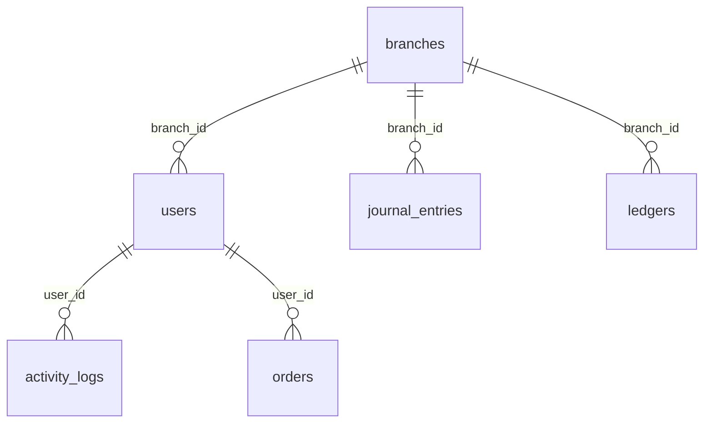
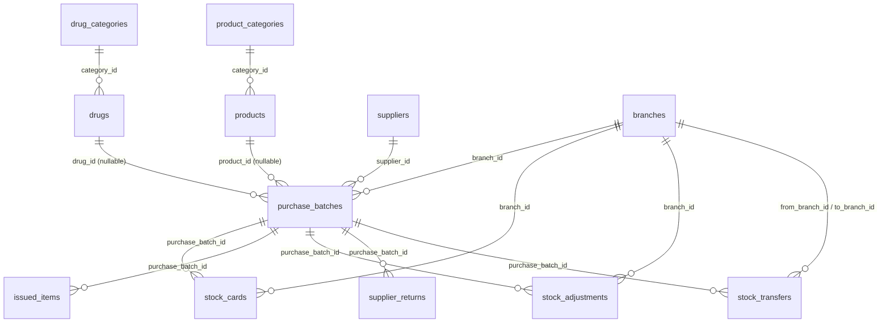
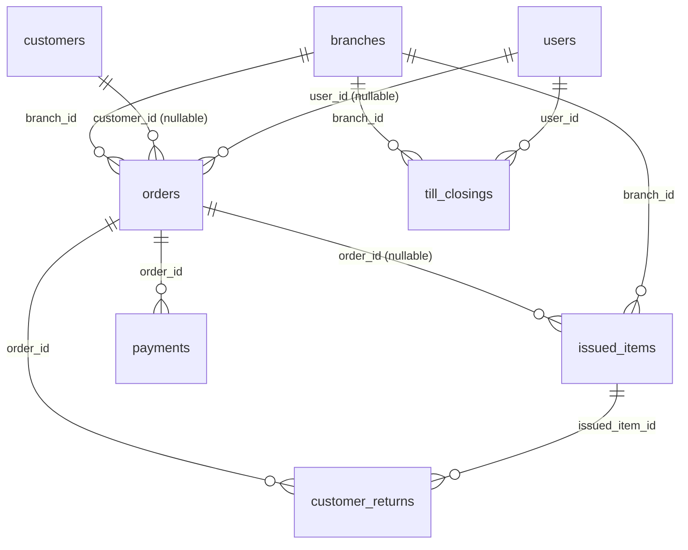
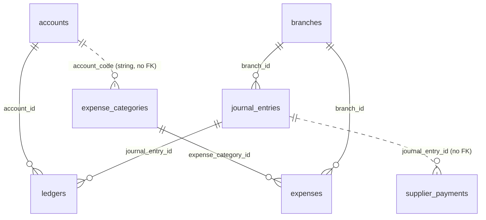
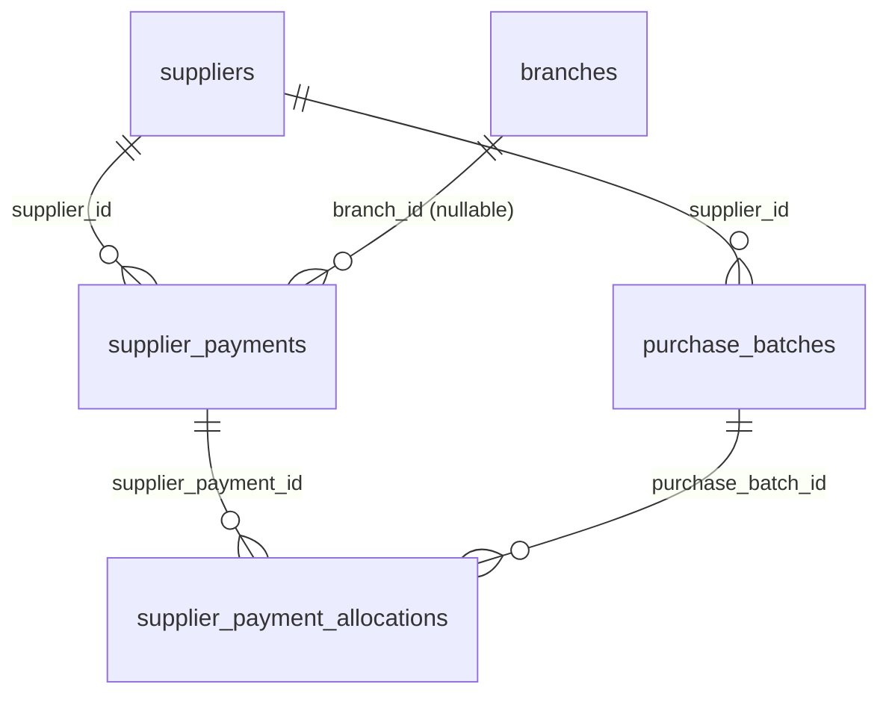

# PMAS — Backend Schema & Data Model

> PMAS (Pharmacy Management System) backend reference, reconstructed from the
> real application code: migrations, Eloquent models, seeders and `routes/web.php`.
> Application code was **not** modified to produce this document.

## How this document was produced

- **Sources of truth (in priority order):** `database/migrations/*`, `app/Models/*`,
  `database/seeders/*`, `routes/web.php`, the controllers and `app/Services/*`.
- **Live database comparison:** a MySQL database **was available** (MySQL 8.0.46,
  database `pmas`, `127.0.0.1:3306`) and was compared against. `php artisan migrate:status`
  was run and a full schema dump (columns, indexes, foreign keys, delete rules, row
  counts) was taken from `information_schema`.
- **Migration status at time of writing:** 37 migrations are `Ran`; the newest one,
  `2026_10_12_000001_add_performance_indexes`, is **`Pending`** — i.e. the live
  database does **not** yet have those indexes. This is called out in section 12.
- Where migrations, models, seeders and the live database disagree, the disagreement
  is stated explicitly.

Legend used in the tables below:

- **Null** = `YES`/`NO` from the live database (matches migrations unless noted).
- **Branch-scoped** = how rows are limited per branch in code (there is no global
  scope or branch trait — scoping is done inside each controller/query).
- **LogsActivity** = the model uses `App\Traits\LogsActivity` (auto-writes `activity_logs`).

---

## 1. Overview of the data domains

| Domain | Tables | Notes |
|---|---|---|
| Users & roles | `users`, `personal_access_tokens`, `sessions`, `password_reset_tokens`, `activity_logs` | Roles live on `users.role` (enum). Activity is logged automatically by the `LogsActivity` trait. |
| Branches | `branches` | **This is a single-branch install.** Branch management (the CRUD screen, every branch picker, and stock transfers) was removed. The `branches` table and every `branch_id` column were deliberately kept so existing records, reports and the row-scoping checks keep working. New records are stamped automatically by `Branch::resolveId()` / `Branch::current()` instead of asking. `users.branch_id` NULL still = Owner/Admin with unrestricted access. |
| Products & stock (drugs) | `drug_categories`, `drugs`, `purchase_batches`, `stock_cards`, `issued_items`, `stock_adjustments` | Drugs are the prescription catalog; stock is held as `purchase_batches.quantity_remaining`. |
| Products & stock (retail) | `product_categories`, `products` | Added later (2026-09-02) into the same `purchase_batches` / `issued_items` tables via a nullable `product_id`. |
| Sales & payments | `orders`, `issued_items`, `payments`, `customer_returns`, `till_closings` | A sale is one `orders` row with one or many `payments` rows that must sum to the order total. |
| Purchases & suppliers | `suppliers`, `purchase_batches`, `supplier_returns`, `supplier_payments`, `supplier_payment_allocations` | "Pay later" purchases create a payable; balances are always **derived from `purchase_batches.amount_paid`**, never stored separately. |
| Accounting | `accounts`, `journal_entries`, `ledgers` | All postings go through `AccountingService::postEntry()`. `reference_type` / `reference_id` link entries to the business record. |
| Expenses | `expense_categories`, `expenses` | Each category maps to a GL `account_code`; expenses post expense-account-up / payment-account-down. Soft-deleted with a reversal entry. |
| Settings | `settings` | Key/value store (branding, VAT rate, supplier alert window). |
| Logs | `activity_logs` | Written by the `LogsActivity` trait (`created`/`updated`/`deleted`). |
| Framework | `cache`, `cache_locks`, `jobs`, `job_batches`, `failed_jobs`, `migrations` | Standard Laravel scaffolding; not part of the pharmacy domain. |

---

## 2. Tables

### 2.1 `users`

- **Purpose:** staff accounts and role/branch assignment.
- **PK:** `id`. **Unique:** `email`, `username`. **FK:** `branch_id → branches.id` (ON DELETE SET NULL).
- **Indexes:** `PRIMARY`, `users_email_unique`, `users_username_unique`, `users_branch_id_foreign`.
- **Soft deletes:** no. **LogsActivity:** yes. **Branch-scoped:** the user's own `branch_id`; NULL means all-branch (Owner/Admin).
- **Login:** staff sign in with `username` + password (`AuthController::login`); `email` is still collected when an account is created but is no longer a login identifier. Usernames are stored lower-case.

| Column | Type | Null | Default | Notes |
|---|---|---|---|---|
| id | bigint unsigned | NO | — | auto-increment |
| name | varchar(255) | NO | — | |
| username | varchar(255) | YES | NULL | unique; the login identifier, stored lower-case (model mutator); added by `2026_10_16_000001` and backfilled from the email local part |
| email | varchar(255) | NO | — | unique; not used to sign in |
| email_verified_at | timestamp | YES | NULL | never populated by app code |
| password | varchar(255) | NO | — | hashed cast |
| active | tinyint(1) | NO | 1 | added by base `create_users`; the later `add_active` migration is a **no-op** (column already exists) |
| remember_token | varchar(100) | YES | NULL | |
| created_at / updated_at | timestamp | YES | NULL | |
| branch_id | bigint unsigned | YES | NULL | FK → branches |
| role | **enum('owner_admin','branch_manager','pharmacist_clerk')** | NO | 'pharmacist_clerk' | see §12: the base migration creates the enum; the later `2026_08_30` migration would add a *varchar* `role` but is a no-op because the column already exists |

### 2.2 `branches`

- **Purpose:** physical pharmacy locations.
- **PK:** `id`. No unique constraints. No FKs.
- **Soft deletes:** no. **LogsActivity:** yes. **Branch-scoped:** it is the branch entity itself.

| Column | Type | Null | Default |
|---|---|---|---|
| id | bigint unsigned | NO | — |
| name | varchar(255) | NO | — |
| address | text | YES | NULL |
| phone | varchar(255) | YES | NULL |
| created_at / updated_at | timestamp | YES | NULL |

### 2.3 `drug_categories`

- **Purpose:** grouping for drugs.
- **PK:** `id`. **No unique on `name`** (product categories do have one — see §12).
- **Soft deletes:** no. **LogsActivity:** yes. **Branch-scoped:** no (global).

| Column | Type | Null | Default |
|---|---|---|---|
| id | bigint unsigned | NO | — |
| name | varchar(255) | NO | — |
| description | text | YES | NULL |
| created_at / updated_at | timestamp | YES | NULL |

### 2.4 `drugs`

- **Purpose:** prescription drug catalog (global, not per branch).
- **PK:** `id`. **FK:** `category_id → drug_categories.id` (ON DELETE CASCADE). **No unique constraints.**
- **Soft deletes:** no. **LogsActivity:** yes. **Branch-scoped:** no.

| Column | Type | Null | Default | Notes |
|---|---|---|---|---|
| id | bigint unsigned | NO | — | |
| name | varchar(255) | NO | — | |
| generic_name | varchar(255) | YES | NULL | |
| strength | varchar(255) | YES | NULL | |
| form | varchar(255) | YES | NULL | |
| category_id | bigint unsigned | NO | — | FK |
| unit_of_measure | varchar(255) | NO | 'pcs' | base unit label; seeder uses values like `tablet`, `capsule`, `sachet` |
| units_per_strip | int unsigned | NO | 1 | |
| strips_per_pack | int unsigned | NO | 1 | |
| minimum_stock_level | decimal(8,2) | NO | 0.00 | |
| created_at / updated_at | timestamp | YES | NULL | |

### 2.5 `suppliers`

- **PK:** `id`. **No unique constraints** on name/email. **No FKs.**
- **Soft deletes:** no. **LogsActivity:** yes. **Branch-scoped:** no.

| Column | Type | Null | Default |
|---|---|---|---|
| id | bigint unsigned | NO | — |
| name | varchar(255) | NO | — |
| phone | varchar(255) | YES | NULL |
| default_credit_days | smallint unsigned | YES | NULL |
| created_at / updated_at | timestamp | YES | NULL |
| address | text | YES | NULL |
| contact_person | varchar(255) | YES | NULL |
| email | varchar(255) | YES | NULL |

### 2.6 `customers`

- **PK:** `id`. **No unique constraints.** **No FKs.**
- **Soft deletes:** no. **LogsActivity:** yes. **Branch-scoped:** no (the app explicitly shows customers to all branches).

| Column | Type | Null | Default |
|---|---|---|---|
| id | bigint unsigned | NO | — |
| name | varchar(255) | NO | — |
| phone | varchar(255) | YES | NULL |
| created_at / updated_at | timestamp | YES | NULL |
| is_recurring | tinyint(1) | NO | 0 |
| reminder_interval_days | int | YES | NULL |
| condition_note | varchar(255) | YES | NULL |
| email | varchar(255) | YES | NULL |
| address | text | YES | NULL |

### 2.7 `product_categories`

- **PK:** `id`. **Unique:** `name`.
- **Soft deletes:** no. **LogsActivity:** yes. **Branch-scoped:** no.

| Column | Type | Null | Default |
|---|---|---|---|
| id | bigint unsigned | NO | — |
| name | varchar(255) | NO | — (unique) |
| description | text | YES | NULL |
| active | tinyint(1) | NO | 1 |
| created_at / updated_at | timestamp | YES | NULL |

### 2.8 `products`

- **Purpose:** retail (non-drug) catalog.
- **PK:** `id`. **Unique:** `sku` (nullable). **FK:** `category_id → product_categories.id` (ON DELETE RESTRICT).
- **Soft deletes:** no. **LogsActivity:** yes. **Branch-scoped:** no.

| Column | Type | Null | Default |
|---|---|---|---|
| id | bigint unsigned | NO | — |
| name | varchar(255) | NO | — |
| sku | varchar(255) | YES | NULL (unique) |
| category_id | bigint unsigned | NO | — (FK) |
| brand | varchar(255) | YES | NULL |
| description | text | YES | NULL |
| purchase_price | decimal(10,2) | NO | 0.00 |
| selling_price | decimal(10,2) | NO | 0.00 |
| minimum_stock | decimal(10,2) | NO | 0.00 |
| active | tinyint(1) | NO | 1 |
| created_at / updated_at | timestamp | YES | NULL |

### 2.9 `purchase_batches`

- **Purpose:** the stock unit — one received batch of a drug or product, with its payment/credit details.
- **PK:** `id`. **FKs:** `drug_id → drugs.id` (SET NULL), `product_id → products.id` (RESTRICT), `supplier_id → suppliers.id` (CASCADE), `branch_id → branches.id` (CASCADE).
- **Unique:** none. **Indexes (live):** FKs only + `purchase_batches_purchase_ref_index` (index on `purchase_ref`). The performance-indexes migration (pending) would add `expiry_date`, `purchase_date`, `(payment_method,payment_status)`, `due_date` — **not present live**.
- **Soft deletes:** no. **LogsActivity:** yes. **Branch-scoped:** yes — `branch_id`, filtered in `PurchaseController::index`, `AlertController`, `ReportController`, `StockAdjustmentController`, `ReturnController`, and via `SupplierOwedService::applyScope`.

| Column | Type | Null | Default | Notes |
|---|---|---|---|---|
| id | bigint unsigned | NO | — | |
| drug_id | bigint unsigned | YES | NULL | FK, nullable (exactly one of drug_id/product_id is set) |
| product_id | bigint unsigned | YES | NULL | FK |
| supplier_id | bigint unsigned | NO | — | FK |
| branch_id | bigint unsigned | NO | — | FK |
| batch_number | varchar(255) | NO | — | **not unique**, despite a controller comment claiming a unique(batch_number, supplier_id) constraint |
| quantity_received | int | NO | — | |
| quantity_remaining | int | NO | — | see §12: the `add_quantity_remaining` migration is a no-op, so this stays NOT NULL |
| cost_per_unit | decimal(10,2) | NO | — | base-unit cost |
| selling_price_per_unit | decimal(10,2) | NO | — | base-unit price |
| expiry_date | date | YES | NULL | **Mandatory on purchase entry** (`items.*.expiry_date` is `required|date|after:today`). The column stays nullable only so rows entered before this rule, and stock transfers from them, still work. Stock that never expires uses a far-future date (e.g. 2099-12-31). |
| purchase_date | date | NO | — | |
| payment_status | varchar(20) | NO | 'paid' | `paid` \| `unpaid` \| `partial` (no DB enum) |
| amount_paid | decimal(12,2) | NO | 0.00 | |
| due_date | date | YES | NULL | |
| payment_method | varchar(30) | YES | NULL | includes `pay_later` |
| payment_reference | varchar(255) | YES | NULL | |
| check_number | varchar(100) | YES | NULL | |
| check_date | date | YES | NULL | |
| check_bank | varchar(255) | YES | NULL | |
| purchase_ref | varchar(40) | YES | NULL | groups multi-line purchases into one payable invoice |
| supplier_invoice_no | varchar(100) | YES | NULL | |
| created_at / updated_at | timestamp | YES | NULL | |

### 2.10 `stock_cards`

- **Purpose:** immutable stock movement log (in/out/transfer).
- **PK:** `id`. **FKs:** `purchase_batch_id → purchase_batches.id` (CASCADE), `branch_id → branches.id` (CASCADE).
- **Indexes (live):** FKs only. The pending migration would add `(reference_type, reference_id)`.
- **`transaction_type`** is a DB **enum('in','out','transfer_in','transfer_out')**.
- **Soft deletes:** no. **LogsActivity:** **no**. **Branch-scoped:** yes (`branch_id`).

| Column | Type | Null | Default |
|---|---|---|---|
| id | bigint unsigned | NO | — |
| purchase_batch_id | bigint unsigned | NO | — |
| branch_id | bigint unsigned | NO | — |
| transaction_type | enum(in,out,transfer_in,transfer_out) | NO | — |
| quantity | int | NO | — |
| unit_cost | decimal(10,2) | NO | — |
| total_amount | decimal(12,2) | NO | — |
| reference_type | varchar(255) | NO | — |
| reference_id | bigint unsigned | NO | — |
| transaction_date | timestamp | NO | — |
| created_at / updated_at | timestamp | YES | NULL |

Note: `reference_type` values written by code are `purchase`, `sale`, `adjustment`, `customer_return`, `supplier_return`, `transfer`. `TransferService` hard-codes `reference_id => 0` for transfers.

### 2.11 `issued_items`

- **Purpose:** sale line items (drug or product).
- **PK:** `id`. **FKs:** `order_id → orders.id` (CASCADE, nullable), `purchase_batch_id → purchase_batches.id` (CASCADE), `product_id → products.id` (RESTRICT, nullable), `customer_id → customers.id` (SET NULL, nullable), `branch_id → branches.id` (CASCADE).
- **Indexes (live):** FKs only. The pending migration would add `issue_date`.
- **Soft deletes:** no. **LogsActivity:** yes. **Branch-scoped:** yes (`branch_id`).

| Column | Type | Null | Default | Notes |
|---|---|---|---|---|
| id | bigint unsigned | NO | — | |
| order_id | bigint unsigned | YES | NULL | |
| purchase_batch_id | bigint unsigned | NO | — | |
| product_id | bigint unsigned | YES | NULL | |
| customer_id | bigint unsigned | YES | NULL | |
| branch_id | bigint unsigned | NO | — | |
| quantity_issued | int | NO | — | base units |
| selling_price_per_unit | decimal(10,2) | NO | — | base unit |
| total_amount | decimal(12,2) | NO | — | |
| issue_date | timestamp | NO | — | |
| created_at / updated_at | timestamp | YES | NULL | |

### 2.12 `stock_transfers`

- **Purpose:** inter-branch stock movement header.
- **PK:** `id`. **FKs:** `from_branch_id`/`to_branch_id` → `branches.id` (CASCADE), `purchase_batch_id → purchase_batches.id` (CASCADE).
- **Soft deletes:** no. **LogsActivity:** yes. **Branch-scoped:** yes — `index` shows rows where the user's branch is source **or** destination.

| Column | Type | Null | Default |
|---|---|---|---|
| id | bigint unsigned | NO | — |
| from_branch_id | bigint unsigned | NO | — |
| to_branch_id | bigint unsigned | NO | — |
| purchase_batch_id | bigint unsigned | NO | — |
| quantity | int | NO | — |
| unit_cost | decimal(10,2) | NO | — |
| total_amount | decimal(12,2) | YES | NULL |
| transfer_date | timestamp | NO | — |
| status | varchar(255) | NO | 'completed' |
| created_at / updated_at | timestamp | YES | NULL |

### 2.13 `orders`

- **Purpose:** a sale (one per checkout).
- **PK:** `id`. **FKs:** `branch_id → branches.id` (CASCADE), `customer_id → customers.id` (SET NULL, nullable), `user_id → users.id` (SET NULL, nullable).
- **Soft deletes:** no. **LogsActivity:** yes. **Branch-scoped:** yes (`branch_id`).

| Column | Type | Null | Default | Notes |
|---|---|---|---|---|
| id | bigint unsigned | NO | — | |
| branch_id | bigint unsigned | NO | — | |
| customer_id | bigint unsigned | YES | NULL | NULL = walk-in/anonymous |
| user_id | bigint unsigned | YES | NULL | cashier |
| total_amount | decimal(12,2) | NO | 0.00 | |
| status | varchar(255) | NO | 'completed' | only `completed` is written by code |
| created_at / updated_at | timestamp | YES | NULL | |

### 2.14 `payments`

- **Purpose:** one or more payment rows per order (split payments).
- **PK:** `id`. **FK:** `order_id → orders.id` (CASCADE).
- **Soft deletes:** no. **LogsActivity:** yes. **Branch-scoped:** via `order`.

| Column | Type | Null | Default | Notes |
|---|---|---|---|---|
| id | bigint unsigned | NO | — | |
| order_id | bigint unsigned | NO | — | |
| payment_method | varchar(255) | NO | — | one of `Payment::METHODS` (no `pay_later`) |
| amount | decimal(12,2) | NO | — | |
| created_at / updated_at | timestamp | YES | NULL | |

### 2.15 `till_closings`

- **Purpose:** end-of-shift cash reconciliation per cashier/branch. The difference between counted and expected cash is posted to `5200 Cash Over/Short` (`till_closing`, see §6).
- **PK:** `id`. **FKs:** `user_id → users.id` (CASCADE), `branch_id → branches.id` (CASCADE).
- **Soft deletes:** no. **LogsActivity:** yes. **Branch-scoped:** yes (`branch_id`).

| Column | Type | Null | Default |
|---|---|---|---|
| id | bigint unsigned | NO | — |
| user_id | bigint unsigned | NO | — |
| branch_id | bigint unsigned | NO | — |
| period_start | timestamp | NO | — |
| closed_at | timestamp | NO | — |
| expected_cash | decimal(12,2) | NO | — |
| counted_cash | decimal(12,2) | NO | — |
| variance | decimal(12,2) | NO | — |
| notes | text | YES | NULL |
| created_at / updated_at | timestamp | YES | NULL |

### 2.16 `stock_adjustments`

- **Purpose:** formal write-off of damaged/lost/expired stock.
- **PK:** `id`. **FKs:** `purchase_batch_id → purchase_batches.id` (CASCADE), `branch_id → branches.id` (CASCADE), `user_id → users.id` (SET NULL, nullable).
- **Soft deletes:** no. **LogsActivity:** yes. **Branch-scoped:** yes (`branch_id`).

| Column | Type | Null | Default | Notes |
|---|---|---|---|---|
| id | bigint unsigned | NO | — | |
| purchase_batch_id | bigint unsigned | NO | — | |
| branch_id | bigint unsigned | NO | — | |
| user_id | bigint unsigned | YES | NULL | |
| quantity | int | NO | — | |
| unit_cost | decimal(10,2) | NO | — | |
| total_amount | decimal(12,2) | NO | — | |
| reason | varchar(255) | NO | — | app values: `damaged`, `lost`, `expired`, `other` (`StockAdjustment::REASONS`) |
| notes | varchar(255) | YES | NULL | |
| created_at / updated_at | timestamp | YES | NULL | |

### 2.17 `customer_returns`

- **Purpose:** customer return line (restocks the original batch + refunds).
- **PK:** `id`. **FKs:** `order_id`/`issued_item_id`/`purchase_batch_id`/`branch_id` → CASCADE; `user_id → users.id` (SET NULL, nullable).
- **Soft deletes:** no. **LogsActivity:** yes. **Branch-scoped:** yes (`branch_id`).

| Column | Type | Null | Default | Notes |
|---|---|---|---|---|
| id | bigint unsigned | NO | — | |
| order_id | bigint unsigned | NO | — | |
| issued_item_id | bigint unsigned | NO | — | |
| purchase_batch_id | bigint unsigned | NO | — | |
| branch_id | bigint unsigned | NO | — | |
| user_id | bigint unsigned | YES | NULL | |
| quantity | int | NO | — | |
| unit_cost | decimal(10,2) | NO | — | |
| cost_amount | decimal(12,2) | NO | — | |
| refund_amount | decimal(12,2) | NO | — | |
| refund_method | varchar(255) | NO | — | one of `Payment::METHODS` |
| notes | varchar(255) | YES | NULL | |
| created_at / updated_at | timestamp | YES | NULL | |

### 2.18 `supplier_returns`

- **Purpose:** return of stock to a supplier (reverses inventory and AP at cost).
- **PK:** `id`. **FKs:** `purchase_batch_id`/`branch_id` CASCADE; `supplier_id → suppliers.id` (SET NULL, nullable); `user_id → users.id` (SET NULL, nullable).
- **Soft deletes:** no. **LogsActivity:** yes. **Branch-scoped:** yes (`branch_id`).

| Column | Type | Null | Default |
|---|---|---|---|
| id | bigint unsigned | NO | — |
| purchase_batch_id | bigint unsigned | NO | — |
| supplier_id | bigint unsigned | YES | NULL |
| branch_id | bigint unsigned | NO | — |
| user_id | bigint unsigned | YES | NULL |
| quantity | int | NO | — |
| unit_cost | decimal(10,2) | NO | — |
| total_amount | decimal(12,2) | NO | — |
| notes | varchar(255) | YES | NULL |
| created_at / updated_at | timestamp | YES | NULL |

### 2.19 `supplier_payments`

- **Purpose:** a payment issued to a supplier (audit record; balances stay on `purchase_batches`).
- **PK:** `id`. **Unique:** `payment_number`. **FKs:** `supplier_id → suppliers.id` (CASCADE), `branch_id → branches.id` (SET NULL, nullable).
  `journal_entry_id` has **no FK constraint** (plain nullable bigint).
- **Indexes:** `payment_number` unique, `(supplier_id, payment_date)`, `branch_id`.
- **Soft deletes:** no. **LogsActivity:** yes. **Branch-scoped:** yes (`branch_id`).

| Column | Type | Null | Default |
|---|---|---|---|
| id | bigint unsigned | NO | — |
| payment_number | varchar(40) | NO | — (unique) |
| supplier_id | bigint unsigned | NO | — |
| branch_id | bigint unsigned | YES | NULL |
| payment_date | date | NO | — |
| amount | decimal(12,2) | NO | — |
| amount_applied | decimal(12,2) | NO | 0.00 |
| overpayment | decimal(12,2) | NO | 0.00 |
| payment_method | varchar(30) | NO | — |
| payment_reference | varchar(255) | YES | NULL |
| check_number | varchar(100) | YES | NULL |
| check_date | date | YES | NULL |
| check_bank | varchar(255) | YES | NULL |
| note | text | YES | NULL |
| journal_entry_id | bigint unsigned | YES | NULL (no FK) |
| created_at / updated_at | timestamp | YES | NULL |

### 2.20 `supplier_payment_allocations`

- **Purpose:** how one supplier payment was spread across purchase batches.
- **PK:** `id`. **FKs:** `supplier_payment_id → supplier_payments.id` (CASCADE), `purchase_batch_id → purchase_batches.id` (CASCADE).
- **Indexes:** FKs + `purchase_ref`.
- **Soft deletes:** no. **LogsActivity:** **no**. **Branch-scoped:** via the parent payment/batch.

| Column | Type | Null | Default |
|---|---|---|---|
| id | bigint unsigned | NO | — |
| supplier_payment_id | bigint unsigned | NO | — |
| purchase_batch_id | bigint unsigned | NO | — |
| purchase_ref | varchar(40) | YES | NULL |
| amount | decimal(12,2) | NO | — |
| created_at / updated_at | timestamp | YES | NULL |

### 2.21 `accounts`

- **Purpose:** chart of accounts (GL accounts).
- **PK:** `id`. **Unique:** `code`. **`type`** is a DB **enum('asset','liability','equity','revenue','expense')**.
- **Soft deletes:** no. **LogsActivity:** yes. **Branch-scoped:** no (global chart).

| Column | Type | Null | Default |
|---|---|---|---|
| id | bigint unsigned | NO | — |
| name | varchar(255) | NO | — |
| code | varchar(255) | NO | — (unique) |
| type | enum(asset,liability,equity,revenue,expense) | NO | — |
| description | varchar(255) | YES | NULL |
| active | tinyint(1) | NO | 1 |
| created_at / updated_at | timestamp | YES | NULL |

### 2.22 `journal_entries`

- **Purpose:** double-entry journal header.
- **PK:** `id`. **Unique:** `voucher_number`. **FK:** `branch_id → branches.id` (CASCADE).
- **`reference_type`/`reference_id`** are a polymorphic link (no FK).
- **Soft deletes:** no. **LogsActivity:** yes. **Branch-scoped:** yes (`branch_id`).

| Column | Type | Null | Default | Notes |
|---|---|---|---|---|
| id | bigint unsigned | NO | — | |
| voucher_number | varchar(255) | NO | — | unique; generated `JV-<time>-<rand>` — collision-prone |
| date | date | NO | — | always `now()` at post time |
| description | varchar(255) | NO | — | |
| reference_type | varchar(255) | YES | NULL | `sale`, `purchase`, `supplier_payment`, `expense`, `expense_reversal`, `adjustment`, `customer_return`, `supplier_return`, `manual` |
| reference_id | bigint unsigned | YES | NULL | nullable for `manual` |
| branch_id | bigint unsigned | NO | — | |
| total_debit | decimal(12,2) | NO | — | |
| total_credit | decimal(12,2) | NO | — | |
| created_at / updated_at | timestamp | YES | NULL | |

> The `JournalEntry` model lists `posted` in `$fillable`/`$casts`, but **no `posted` column exists** in migrations or the live DB (see §12).

### 2.23 `ledgers`

- **Purpose:** journal entry lines.
- **PK:** `id`. **FKs:** `journal_entry_id → journal_entries.id` (CASCADE), `account_id → accounts.id` (CASCADE), `branch_id → branches.id` (CASCADE).
- **Soft deletes:** no. **LogsActivity:** **no**. **Branch-scoped:** yes (`branch_id`).

| Column | Type | Null | Default | Notes |
|---|---|---|---|---|
| id | bigint unsigned | NO | — | |
| journal_entry_id | bigint unsigned | NO | — | |
| account_id | bigint unsigned | NO | — | |
| branch_id | bigint unsigned | NO | — | |
| debit | decimal(12,2) | NO | 0.00 | |
| credit | decimal(12,2) | NO | 0.00 | |
| description | varchar(255) | NO | — | |
| created_at / updated_at | timestamp | YES | NULL | |

> The `Ledger` model lists `balance` in `$fillable`/`$casts`, but **no `balance` column exists** (see §12).

### 2.24 `expense_categories`

- **Purpose:** expense categories, each mapped to an expense GL `account_code`.
- **PK:** `id`. **Unique:** `name`. **No FK** on `account_code` (it is a string, not a reference to `accounts.code`).
- **Soft deletes:** no. **LogsActivity:** yes. **Branch-scoped:** no.

| Column | Type | Null | Default |
|---|---|---|---|
| id | bigint unsigned | NO | — |
| name | varchar(255) | NO | — (unique) |
| account_code | varchar(10) | NO | — |
| active | tinyint(1) | NO | 1 |
| allow_recurring | tinyint(1) | NO | 0 |
| created_at / updated_at | timestamp | YES | NULL |

### 2.25 `expenses`

- **Purpose:** a recorded expense (rent, salaries, …).
- **PK:** `id`. **FKs:** `expense_category_id → expense_categories.id` (RESTRICT), `branch_id → branches.id` (RESTRICT).
- **Indexes:** `(branch_id, expense_date)`, `(expense_category_id, expense_date)`.
- **Soft deletes:** **yes** (`deleted_at`). **LogsActivity:** yes. **Branch-scoped:** yes (`branch_id`).

| Column | Type | Null | Default | Notes |
|---|---|---|---|---|
| id | bigint unsigned | NO | — | |
| expense_date | date | NO | — | |
| expense_category_id | bigint unsigned | NO | — | |
| branch_id | bigint unsigned | NO | — | |
| amount | decimal(12,2) | NO | — | |
| payment_method | varchar(30) | NO | — | `Payment::METHODS` (never `pay_later`) |
| payment_reference | varchar(255) | YES | NULL | |
| check_number | varchar(100) | YES | NULL | |
| check_date | date | YES | NULL | |
| check_bank | varchar(255) | YES | NULL | |
| note | text | YES | NULL | |
| repeat_monthly | tinyint(1) | NO | 0 | |
| next_due_date | date | YES | NULL | |
| deleted_at | timestamp | YES | NULL | soft delete |
| created_at / updated_at | timestamp | YES | NULL | |

### 2.26 `settings`

- **Purpose:** key/value business settings.
- **PK:** `id`. **Unique:** `key`.
- **Soft deletes:** no. **LogsActivity:** **no**. **Branch-scoped:** no (global; the model comments mention an unused `branch:{id}:{key}` convention).

| Column | Type | Null | Default |
|---|---|---|---|
| id | bigint unsigned | NO | — |
| key | varchar(255) | NO | — (unique) |
| value | text | YES | NULL |
| created_at / updated_at | timestamp | YES | NULL |

### 2.27 `activity_logs`

- **Purpose:** automatic audit trail written by `LogsActivity`.
- **PK:** `id`. **FK:** `user_id → users.id` (SET NULL, nullable).
- **Indexes:** `(model_type, model_id)`, `user_id`.
- **Soft deletes:** no. **LogsActivity:** **no** (would recurse). **Branch-scoped:** no direct column; scoped via the logged model.

| Column | Type | Null | Default | Notes |
|---|---|---|---|---|
| id | bigint unsigned | NO | — | |
| user_id | bigint unsigned | YES | NULL | NULL for seeders/console |
| action | varchar(255) | NO | — | `created` \| `updated` \| `deleted` (app convention, no DB enum) |
| model_type | varchar(255) | NO | — | `class_basename` of the model |
| model_id | bigint unsigned | NO | — | |
| changes | json | YES | NULL | new values (create) / changed fields (update); empty on delete; `password` stripped |
| created_at / updated_at | timestamp | YES | NULL | |

### 2.28 Framework tables

| Table | PK | Notable columns | Notes |
|---|---|---|---|
| `password_reset_tokens` | `email` | email, token, created_at | unused by app code |
| `sessions` | `id` | user_id (indexed), ip_address, user_agent, payload, last_activity | file/db session store |
| `cache` | `key` | value, expiration (indexed) | |
| `cache_locks` | `key` | owner, expiration (indexed) | |
| `jobs` | `id` | queue (indexed), payload, attempts, reserved_at, available_at, created_at | `QUEUE_CONNECTION=sync` |
| `job_batches` | `id` | name, total_jobs, pending_jobs, failed_jobs, failed_job_ids, options, … | |
| `failed_jobs` | `id` | uuid (unique), connection, queue, payload, exception, failed_at | |
| `personal_access_tokens` | `id` | tokenable (morphs), token (unique), abilities, … | Sanctum; `HasApiTokens` on `User` |
| `migrations` | `id` | migration, batch | |

---

## 3. Relationships and query scopes per model

| Model | Relations | Scopes / notable methods |
|---|---|---|
| `User` | `branch()` belongsTo `Branch` | `roleLabel()`; role constants `ROLES` |
| `Branch` | hasMany `purchaseBatches`, `stockCards`, `issuedItems`, `fromTransfers`, `toTransfers`, `journalEntries`, `ledgers` | — |
| `Account` | hasMany `ledgers` | — |
| `Drug` | `category()` belongsTo `DrugCategory`; hasMany `purchaseBatches` | accessor `current_stock` (sum `quantity_remaining`); packing helpers `unitsPerStrip/stripsPerPack/unitsPerPack/baseUnitsPer/toBaseQuantity/pricePerBase/packingOptions` |
| `DrugCategory` | hasMany `drugs` (`category_id`) | — |
| `Product` | `category()` belongsTo `ProductCategory`; hasMany `purchaseBatches` | accessor `current_stock`, `minimum_stock_level`; base-unit stubs |
| `ProductCategory` | hasMany `products` | — |
| `Supplier` | hasMany `purchaseBatches` | — |
| `Customer` | hasMany `issuedItems` | `isDueForReminder()` |
| `PurchaseBatch` | belongsTo `drug`, `product`, `supplier`, `branch`; hasMany `stockCards`, `issuedItems` | accessors `total_cost`, `balance_owed`, `available_quantity`; `payment_label()`, `status_label()`, `isExpired()`, `isNearExpiry()` |
| `StockCard` | belongsTo `purchaseBatch`, `branch` | — |
| `IssuedItem` | belongsTo `order`, `purchaseBatch`, `product`, `customer`, `branch`; hasMany `customerReturns` | `quantityReturned()`, `quantityReturnable()` |
| ~~`StockTransfer`~~ | *(removed — stock transfers were deleted)* | - |
| `StockAdjustment` | belongsTo `purchaseBatch`, `branch`, `user` | `REASONS` constant; `reasonLabel()` |
| `Order` | belongsTo `branch`, `customer`, `user`; hasMany `items` (IssuedItem), `payments`, `customerReturns` | `amountPaid()`, `vatBreakdown()` |
| `Payment` | belongsTo `order` | `methodLabel()`; constants `METHODS`, `ACCOUNT_CODES`, `PAY_LATER`, `OWED_TO_SUPPLIERS_ACCOUNT`; `accountCodeFor()` |
| `CustomerReturn` | belongsTo `order`, `issuedItem`, `purchaseBatch`, `branch`, `user` | `refundMethodLabel()` |
| `SupplierReturn` | belongsTo `purchaseBatch`, `supplier`, `branch`, `user` | — |
| `TillClosing` | belongsTo `user`, `branch` | — |
| `SupplierPayment` | belongsTo `supplier`, `branch`; hasMany `allocations` | `methodLabel()` |
| `SupplierPaymentAllocation` | belongsTo `payment` (`supplier_payment_id`), `batch` (`purchase_batch_id`) | — |
| `ExpenseCategory` | hasMany `expenses` | **`scopeActive()`** (`where active = true`) — the only named query scope in the app |
| `Expense` | belongsTo `category` (`expense_category_id`), `branch` | `payment_label()`, `reminderDate()` |
| `JournalEntry` | belongsTo `branch`; hasMany `ledgers` | — |
| `Ledger` | belongsTo `journalEntry`, `account`, `branch` | — |
| `ActivityLog` | belongsTo `user` | — |
| `Setting` | — | static `value()`, `allCached()`, `put()`, `vatRatePercent()` |
| ~~`TransferService`~~ | *(removed — stock transfers were deleted)* | - |
| `InventoryService` | — | domain service |
| `SupplierOwedService` | — | `supplierSummary()`, `supplierInvoices()`, `reminderData()`, `statusForDate()`, `applyScope()` |
| `AccountingService` | — | `postEntry()`, `recordSale()`, `recordWriteOff()`, `recordCustomerReturn()`, `recordSupplierReturn()` |

---

## 4. Mermaid ER diagrams (one per domain)

### 4.1 Users, roles, branches, logs

### 4.2 Products, stock, purchases (drugs + retail products)

### 4.3 Sales, payments, returns

### 4.4 Accounting (chart of accounts, journals)

### 4.5 Purchases/supplier payments domain

---

## 5. Chart of accounts exactly as seeded, and payment-method mapping

### 5.1 Accounts created by seeders/migrations

`AccountSeeder` seeds 13 accounts; migration `2026_10_11_000007_add_expense_accounts` creates 7 expense accounts (also created by `ExpenseCategorySeeder`). Migration `2026_10_15_000001_ensure_core_posting_accounts` also guarantees the core codes (`1001`, `1002`, `1200`, `3000`, `4000`, `5000`) exist after `migrate` alone, and `2026_10_15_000002_add_cash_over_short_account` creates `5200`. The "digital payment" (`000005`), "inventory shrinkage" (`000008`) and "owed to suppliers" (`2026_10_11_000003`) migrations are idempotent and re-reference codes that the seeder already creates.

| Code | Name | Type | Where defined |
|---|---|---|---|
| 1001 | Cash | asset | `AccountSeeder` |
| 1002 | Accounts Receivable | asset | `AccountSeeder` + `2026_10_15_000001` (opening balances) |
| 1010 | Telebirr | asset | `AccountSeeder` + `2026_08_31_000005` |
| 1011 | CBE Birr | asset | `AccountSeeder` + `2026_08_31_000005` |
| 1012 | Bank | asset | `AccountSeeder` + `2026_08_31_000005` |
| 1013 | Card | asset | `AccountSeeder` + `2026_08_31_000005` |
| 1200 | Inventory | asset | `AccountSeeder` |
| 2000 | Accounts Payable | liability | `AccountSeeder` + `2026_10_11_000003` |
| 3000 | Owner Equity | equity | `AccountSeeder` + `2026_10_15_000001` (opening balances derive capital here) |
| 4000 | Sales Revenue | revenue | `AccountSeeder` |
| 5000 | Cost of Goods Sold | expense | `AccountSeeder` |
| 5100 | Inventory Shrinkage | expense | `AccountSeeder` + `2026_08_31_000008` |
| 5200 | Cash Over/Short | expense | `AccountSeeder` + `2026_10_15_000002` (till-close variance) |
| 6000 | Rent Expense | expense | `2026_10_11_000007` + `ExpenseCategorySeeder` |
| 6010 | Electricity Expense | expense | `2026_10_11_000007` + `ExpenseCategorySeeder` |
| 6020 | Water Expense | expense | `2026_10_11_000007` + `ExpenseCategorySeeder` |
| 6030 | Salaries Expense | expense | `2026_10_11_000007` + `ExpenseCategorySeeder` |
| 6040 | Transport Expense | expense | `2026_10_11_000007` + `ExpenseCategorySeeder` |
| 6050 | Internet & Phone Expense | expense | `2026_10_11_000007` + `ExpenseCategorySeeder` |
| 6090 | Other Expense | expense | `2026_10_11_000007` + `ExpenseCategorySeeder` |

**Live-data differences (not schema):** the live DB originally had 18 accounts — `1002` absent, and `3000` named *"Owner Capital"* (seeded as *"Owner Equity"*). Running `2026_10_15_000001` (which inserts `1002`) and renaming `3000` to *"Owner Equity"* brought it in line with the seeders.

### 5.2 Payment method → account mapping

Defined in `App\Models\Payment`.

`Payment::METHODS`:

| Method key | Label |
|---|---|
| `cash` | Cash |
| `telebirr` | Telebirr |
| `cbe_birr` | CBE Birr |
| `bank_transfer` | Bank Transfer |
| `card` | Card |
| `check` | Check |

`Payment::ACCOUNT_CODES`:

| Method | Account code | Account |
|---|---|---|
| `cash` | 1001 | Cash |
| `telebirr` | 1010 | Telebirr |
| `cbe_birr` | 1011 | CBE Birr |
| `bank_transfer` | 1012 | Bank |
| `card` | 1013 | Card |
| `check` | 1012 | Bank (checks share the bank account) |

`Payment::PAY_LATER = 'pay_later'` and `Payment::OWED_TO_SUPPLIERS_ACCOUNT = '2000'`. `pay_later` is **purchase-only** and is not in `METHODS`; `accountCodeFor()` throws `InvalidArgumentException` for an unknown method.

### 5.3 Expense category → account

| Expense category name | account_code |
|---|---|
| Rent | 6000 |
| Electricity | 6010 |
| Water | 6020 |
| Salaries | 6030 |
| Transport | 6040 |
| Internet and Phone | 6050 |
| Other | 6090 |

New categories created through the UI are mapped to `6090` (Other Expense).

---

## 6. Posting map (`AccountingService::postEntry` call sites)

`postEntry($desc, $branchId, $refType, $refId, $lines)` creates one `journal_entries` row and one `ledgers` row per line, inside a DB transaction, and throws if debits ≠ credits (rounded to 2 dp). Voucher number is `JV-<unix time>-<1000-9999>`.

| # | Business event | Debit account(s) | Credit account(s) | ref_type | ref_id | File / method |
|---|---|---|---|---|---|---|
| 1 | **Sale — revenue** | each payment method's account (`Payment::accountCodeFor`), one debit line per `payments` row | 4000 Sales Revenue | `sale` | `orders.id` | `DispenseController::store` → `AccountingService::recordSale` (`AccountingService.php:63`) |
| 2 | **Sale — COGS** | 5000 COGS | 1200 Inventory | `sale` | `orders.id` | same call → `recordSale` (`AccountingService.php:64`) |
| 3 | **Purchase paid now** (cash/telebirr/cbe/bank/card/check) | 1200 Inventory | method account (check → 1012) | `purchase` | `purchase_batches.id` | `PurchaseController::store` (`PurchaseController.php:172`) |
| 4 | **Purchase on credit (`pay_later`)** | 1200 Inventory | 2000 Accounts Payable | `purchase` | `purchase_batches.id` | `PurchaseController::store` (`PurchaseController.php:172`) |
| 5 | **Supplier payment** | 2000 Accounts Payable (amount applied) | method account | `supplier_payment` | `supplier_payments.id` | `SupplierPaymentController::store` (`SupplierPaymentController.php:189`) |
| 6 | **Expense** | expense category's account (`account_code`) | method account | `expense` | `expenses.id` | `ExpenseController::postExpense` (`ExpenseController.php:212`) |
| 7 | **Expense reversal** (on update and delete) | method account | expense category's account | `expense_reversal` | `expenses.id` | `ExpenseController::reverseExpense` (`ExpenseController.php:228`) |
| 8 | **Stock write-off / adjustment** | 5100 Inventory Shrinkage | 1200 Inventory | `adjustment` | `stock_adjustments.id` | `StockAdjustmentController::store` → `AccountingService::recordWriteOff` (`AccountingService.php:71`) |
| 9 | **Customer return — refund** (only when refund > 0) | 4000 Sales Revenue | refund method account | `customer_return` | `customer_returns.id` | `ReturnController::storeCustomer` → `recordCustomerReturn` (`AccountingService.php:83`) |
| 10 | **Customer return — COGS reversal** (only when cogs > 0) | 1200 Inventory | 5000 COGS | `customer_return` | `customer_returns.id` | same call → `recordCustomerReturn` (`AccountingService.php:90`) |
| 11 | **Supplier return** | 2000 Accounts Payable | 1200 Inventory | `supplier_return` | `supplier_returns.id` | `ReturnController::storeSupplier` → `recordSupplierReturn` (`AccountingService.php:104`) |
| 12 | **Manual journal entry** | user-selected accounts | user-selected accounts | `manual` | `null` | `JournalEntryController::store` (`JournalEntryController.php:66`) |
| 13 | **Till closing** | 1001 Cash (overage) / 5200 Cash Over/Short (shortage) | 5200 (overage) / 1001 (shortage) | `till_closing` | `till_closings.id` | `TillClosingController::store` → `AccountingService::recordTillVariance` (`AccountingService.php`). No entry when the drawer matches. |
| 14 | **Opening balances** | `1001`/`1010`–`1013`/`1002`/`1200` (assets) | `2000` Accounts Payable (liabilities), `3000` Owner Equity (derived) | `opening_balance` | `null` | `OpeningBalanceController::store`. Posts the difference needed to reach the entered figures; owner's capital balances the entry. |

Notes on the above:

- Purchases create **one journal entry per batch line** (`ref_id` = the batch), even when several lines share a `purchase_ref`.
- A customer return creates **up to two** entries (`customer_return` refund + `customer_return` COGS reversal) with the same `ref_id`.
- A sale always creates **two** entries (`sale` revenue + `sale` COGS), with the revenue entry debiting one line per payment method.

---

## 7. Enums and status values

| Concept | Values | Defined where |
|---|---|---|
| User roles | `owner_admin`, `branch_manager`, `pharmacist_clerk` | DB `users.role` **enum** (defined in `2024_01_01_000001_create_pmas_tables.php`); also `User::ROLE_*` / `User::ROLES` |
| `accounts.type` | `asset`, `liability`, `equity`, `revenue`, `expense` | DB enum (`2024_01_01_000001`) |
| `stock_cards.transaction_type` | `in`, `out`, `transfer_in`, `transfer_out` | DB enum (`2024_01_01_000001`) |
| Payment methods (sales) | `cash`, `telebirr`, `cbe_birr`, `bank_transfer`, `card`, `check` | `Payment::METHODS` (model constant; DB column is `varchar`) |
| Payment methods (purchases) | the six above **plus** `pay_later` | `Payment::PAY_LATER` + `Payment::METHODS` (validated in `PurchaseController`) |
| Purchase `payment_status` | `paid`, `unpaid`, `partial` | migration `2026_10_11_000001` default `paid`; `PurchaseBatch::status_label()`; `SupplierOwedService` filters `unpaid`/`partial` |
| Stock adjustment `reason` | `damaged`, `lost`, `expired`, `other` | `StockAdjustment::REASONS` |
| Order `status` | `completed` (only value written) | `orders.status` default `'completed'`; `DispenseController::store` hard-codes it |
| Stock transfer `status` | `completed` (only value written) | `stock_transfers.status` default `'completed'`; `TransferService` hard-codes it |
| Activity log `action` | `created`, `updated`, `deleted` | `LogsActivity` trait (DB column is `varchar`) |
| Supplier-owed status (derived) | `overdue`, `soon`, `ok` | `SupplierOwedService::statusForDate()` (not stored) |
| Supplier invoice status (derived) | `unpaid`, `partial`, `paid` | `SupplierOwedService::supplierInvoices()` (not stored) |

---

## 8. Role and access matrix (from `routes/web.php` + `EnsureUserHasRole`)

Role middleware alias: `role` → `App\Http\Middleware\EnsureUserHasRole` (registered in `bootstrap/app.php`). Any role not listed gets HTTP 403.

| Route group | Middleware | Owner/Admin | Branch Manager | Pharmacist/Clerk |
|---|---|:---:|:---:|:---:|
| `GET /` (login), `POST /`, `POST /login` | public + `throttle:5,1` | ✅ | ✅ | ✅ |
| `POST /logout`, `GET /dashboard`, `GET /profile` | `auth` (any role) | ✅ | ✅ | ✅ |
| Purchases, Dispensing, Till closings, Adjustments, Returns, Drugs, Categories, Products, Product categories, Suppliers, Customers, Alerts, `search-drug` | `role:owner_admin,branch_manager,pharmacist_clerk` | ✅ | ✅ | ✅ |
| Accounts, Journal entries, Reports (inventory/financial/sales/export) | `role:owner_admin,branch_manager` | ✅ | ✅ | ❌ |
| Supplier Owed / Pay supplier, Expenses, Expense categories, Settings branding, Users, Activity logs | `role:owner_admin` | ✅ | ❌ | ❌ |

Notes:

- The `role:owner_admin` groups in the file are three separate `Route::middleware(['role:owner_admin'])` blocks (Part B supplier payments, Part C expenses + Part D settings, and staff accounts) — the same tier.
- `JournalEntryController::index` does `where('branch_id', auth()->user()->branch_id)`. For an Owner/Admin with `branch_id = NULL` this becomes `WHERE branch_id IS NULL` and returns **nothing**, even though the route is reachable — see §12.
- Owner/Admin "all branches" behaviour depends on `branch_id` being NULL and controllers wrapping filters in `if ($user->branch_id)`.

---

## 9. Settings keys

The `settings` table is read through `Setting::value()` (cached 5 min) and `Setting::vatRatePercent()`.

| Key | Seeded default | Set where | Read/used where |
|---|---|---|---|
| `business_name` | `TRUSTMED PHARMACY` (`BrandingSeeder`) | `SettingController::update` | `SettingController::edit`, `EscPosReceipt::forOrder` (fallback `config('pmas.default_business_name')` = `PMAS`) |
| `business_phone` | none (NULL) | `SettingController::update` | `EscPosReceipt` (fallback to branch phone) |
| `business_address` | none (NULL) | `SettingController::update` | `EscPosReceipt` (fallback to branch address) |
| `receipt_header` | none (NULL) | `SettingController::update` | `EscPosReceipt` |
| `receipt_footer` | `Thank you! Take your medicines as directed.` (`BrandingSeeder`) | `SettingController::update` | `EscPosReceipt` |
| `vat_rate_percent` | none (treated as `0`) | `SettingController::update` | `Setting::vatRatePercent()` → `Order::vatBreakdown()`, receipts |
| `brand_primary_color` | `#12A594` (`BrandingSeeder`) | `SettingController::update` | `SettingController::edit`; injected as `--brand-primary` CSS var (`partials/brand-vars.blade.php`) |
| `brand_accent_color` | `#101B2D` (`BrandingSeeder`) | `SettingController::update` | `SettingController::edit`; injected as `--brand-accent` CSS var |
| `logo_path` | `branding/trustmed-logo.png` (`BrandingSeeder`) | `SettingController::update` (upload/remove) | branding views; `public` disk |
| `supplier_alert_days` | `7` (inserted by migration `2026_10_11_000005`, re-asserted by `BrandingSeeder`, fallback `'7'` in code) | `SettingController::update` | `SupplierPaymentController::soonDays`, `AlertController`, `DashboardController`, `AppServiceProvider` sidebar badge |
| `expiry_alert_days` | `90` (fallback `90` in code, seeded by `BrandingSeeder`; only `30`/`60`/`90` accepted, anything else falls back to `90`) | `SettingController::update` | `Setting::expiryAlertDays()` → `AlertController` (expiring-soon window, overridable per-visit by `?expiry=30\|60\|90`), `DashboardController` ("Expiring soon" card) |

Live values observed: `vat_rate_percent = 15`, `business_name = TRUSTMED Pharmacy`, `logo_path = branding/<hash>.png`; `business_phone`, `business_address`, `receipt_header` are NULL. These are owner edits, not seeds.

---

## 10. Business rules enforced in code

**Stock deduction order (FEFO, with FIFO inside a shared expiry date)**
- `InventoryService::selectBatchesForDispensing()` selects batches for the item at the branch with `quantity_remaining > 0` and not expired, ordered by **`expiry_date ASC, purchase_date ASC, id ASC`** — first-expiry-first-out, and within one expiry date oldest-purchased-first.
- The `id` tiebreaker is what makes the order deterministic. Without it, several batches bought on the same day with the same expiry date tie on both date columns and MySQL is free to return them in any order. `purchase_date` is a DATE column, so on its own it is not precise enough.
- Every sale line already records which physical batch it consumed (`issued_items.purchase_batch_id`, `stock_cards.purchase_batch_id`), so traceability never depended on this ordering.
- Out-of-stock is rejected: `if ($batches->sum('quantity_remaining') < $qtyNeeded) throw "Insufficient stock available."`.

**The dispensing marker (`#1 · 40 left`)**
- `InventoryService::dispenseMarkers()` renders next to each item name on the sale screen: which batch goes out first, and how much is left on it.
- It is **recomputed from the batches on every page load** — there is no stored sequence column, so nothing needs renumbering when a batch is deleted or written off.
- It uses `ROW_NUMBER() OVER (ORDER BY expiry_date ASC, purchase_date ASC, id ASC)` — deliberately the same ORDER BY as `selectBatchesForDispensing()`, so the batch the seller is shown is always the batch that is actually consumed.
- Markers are keyed by `catalog_key` (`drug:12` / `product:3`), not by bare id, because a drug id and a product id can be the same number.

**Locking (`lockForUpdate`)**
- `InventoryService::selectBatchesForDispensing()` locks the candidate batch rows.
- `InventoryService::writeOff()`, `restockCustomerReturn()`, `returnToSupplier()` lock the batch (and issued item) before mutating.
- `SupplierPaymentController::store()` locks the supplier's open pay-later lines before allocating.
- All of these run inside `DB::transaction(...)`.
- The outermost stock transaction in each request path allows **3 attempts**, so a transient InnoDB deadlock or lock-wait timeout rolls back and retries instead of surfacing an error to the seller. Retries are on the outermost transaction because that is the only level Laravel retries at (nested calls use savepoints).

**Overpayment / balance checks**
- Supplier payment: `if ($amount > $totalOwed + 0.001)` → validation error "You can't pay more than what is owed". `overpayment` is therefore always 0 by construction.
- Sale: `payments` must sum exactly to the order total (2-dp comparison), else `throw`.
- Customer return: quantity cannot exceed `quantity_issued - already returned` (`returnable`).
- Write-off / supplier return: quantity cannot exceed the batch's `quantity_remaining`, and must be ≥ 1.
- Purchase: quantity per line `min:1`, cost/selling `min:0`.

**Rounding**
- All money is rounded to 2 dp (`round(..., 2)`): COGS, line totals, allocations, refunds, till variance.
- `AccountingService::postEntry` compares `round($debitTotal,2) === round($creditTotal,2)`.
- Account-code selection for payments is exact (`Payment::accountCodeFor` throws for unknown methods).

**Scoping**
- Branch scoping is **per query**, not global: controllers/`SupplierOwedService` apply `where('branch_id', $user->branch_id)` only when the user has a non-null `branch_id`; NULL means all branches.
- Branch ownership guards: `DispenseController::show`, `ReceiptController`, `StockAdjustmentController`, `ReturnController`, `ExpenseController::authorizeBranch` all verify the record's branch matches the user's branch (403 otherwise).
- `JournalEntryController::index` is the exception: unconditional `where('branch_id', ...)`, which breaks for NULL-branch Owner/Admin.
- `customers` have no `branch_id` and are intentionally global.

**Other**
- Packing: purchases and issues convert strip/pack quantities to base units via `toBaseQuantity()` / `pricePerBase()` before storing; stock is always in base units.
- `pay_later` requires a supplier and a due date; non-cash non-check methods require a `payment_reference`; checks require number, date and bank.
- Expense creation requires a resolvable `branch_id` (user's branch or an explicit one).
- Soft delete of an expense always writes an `expense_reversal` journal entry first (update also reverses then re-posts).
- Login refuses inactive users (`users.active`), needs a valid `username` (the email is no longer accepted), and login attempts are rate-limited (`throttle:5,1`; the route is also referenced in an unmerged patch, see §11).

---

## 11. Planned but not yet merged

These are explicitly **not** part of the current `main` schema/behaviour and are listed for completeness only.

- **`pmas_fixes.patch`:** removed during the deployment fixes — its `AccountingServiceTest` / `InventoryServiceTest` were ported to `main` (corrected to the current service signatures), and its login rate limiter is superseded by the routes' `throttle:5,1` plus the per-credential limiter now in `AuthController`.
- **"Part E" sidebar note:** `resources/views/layouts/app.blade.php` contains the comment `{{-- data-sidebar-nav: the element that actually scrolls (Part E) --}}`. There is no other trace of a "Part E" feature (routes, controllers, models); whether it is planned work or a stale label is **unclear**.
- **Performance indexes migration `2026_10_12_000001`:** committed to `main` and now **`Ran`** on the live database (applied during the deployment fixes).
- The remote branch `origin/pharmacy-purchase-payment-implementation-1a0eb` is **behind** `main` (no commits ahead of `main`); it is not future work.

---

## 12. Inconsistencies, missing indexes/constraints, unused columns and risks

> **Status:** this section is the original audit. Since it was written, several items have been fixed and the entries below are marked accordingly. Fixed: the phantom model attributes (#4–5), the `TransferService` and `JournalEntryController` bugs (#20–21), the missing core-account guarantee (#23), the live `accounts` drift (#2), the formerly unused codes `1002`/`3000` (#16), and the till-closing/opening-balance posting gaps (§6 #13–14).

### 12.1 Migrations vs live database

1. **`2026_10_12_000001_add_performance_indexes` (fixed).** Originally Pending; now **applied** to the live DB. It added:
   - `purchase_batches`: `expiry_date`, `purchase_date`, `(payment_method, payment_status)`, `due_date`
   - `issued_items`: `issue_date`
   - `stock_cards`: `(reference_type, reference_id)`
   - `journal_entries`: `(reference_type, reference_id)`
2. **Data drift in `accounts` (fixed).** `1002 Accounts Receivable` was absent live and `3000` mis-named *"Owner Capital"*. Migration `2026_10_15_000001` inserts `1002`, and the live row was renamed to *"Owner Equity"*.
3. **Branding/VAT drift:** live `business_name = "TRUSTMED Pharmacy"` vs seeder `"TRUSTMED PHARMACY"`; live `vat_rate_percent = 15` (no seeder default).

### 12.2 Migrations vs models

4. **`JournalEntry.posted` does not exist.** The model has `posted` in `$fillable` and `$casts: boolean`, but no migration creates the column and it is absent live. Writing/reading it would silently fail or error.
5. **`Ledger.balance` does not exist.** Listed in `$fillable`/`$casts`, but no `balance` column exists in migrations or live.
6. **`users.role` type ambiguity.** `2024_01_01_000001_create_pmas_tables.php` creates `role` as an **enum** plus `branch_id` FK. Later, `2026_08_30_000001_add_role_to_users_table.php` checks `Schema::hasColumn` and (because it already exists) does nothing — so on any install the enum wins and the intended `varchar` never applies. The migration's `down()` also drops `role`, which would conflict with the base migration's `down()`.
7. **`quantity_remaining` nullability.** `2026_08_26` adds it "if not exists", but the base `2024` migration already defines it `NOT NULL`, so the intended nullable change never applies (live: `NOT NULL`).
8. **`users.active` duplicated.** Added in the base `create_users` migration and again (guarded) in `2026_09_02_000004`; harmless but redundant.
9. **`drug_categories.description` duplicated.** Added by both `2026_08_27_000003` and `2026_10_09_000001` (both guarded). Redundant.

### 12.3 Missing constraints / indexes

10. **`purchase_batches.batch_number` is not unique.** `PurchaseController::store` comments claim a `unique(batch_number, supplier_id)` constraint prevents duplicates, but no such unique index exists in migrations or live. Duplicate batch numbers are possible.
11. **`drug_categories.name` is not unique** (unlike `product_categories.name` and `expense_categories.name`). `CatalogSeeder` manually de-duplicates, indicating duplicates have occurred.
12. **`expense_categories.account_code` has no FK** to `accounts.code`. A category can point at an account code that does not exist; `ExpenseController::postExpense` would then fail with `firstOrFail`.
13. **`supplier_payments.journal_entry_id` has no FK** to `journal_entries.id` (unlike many other relations), so a dangling reference is possible.
14. **`activity_logs.model_id` has no composite FK** by design (polymorphic), but there is also no index on `user_id` beyond the FK index; filtering by `action`/`created_at` (used by `ActivityLogController`) is unindexed.
15. **No index on `orders.created_at` / `issued_items.order_id`** beyond FKs, though order lists sort by `latest()`. `till_closings` lookups filter on `(user_id, branch_id, closed_at)` with only single-column FKs.

### 12.4 Unused / phantom columns and data

16. **`accounts` codes formerly unused (fixed):** `1002` and `3000` are now posted by opening balances (`OpeningBalanceController`), and `5200 Cash Over/Short` was added for till-close variance.
17. **`supplier_payment_allocations.purchase_ref`** duplicates the value already on `purchase_batches.purchase_ref`; it is written but never read for balance logic.
18. **`StockTransfer.total_amount`** is write-only in practice (set by `TransferService`); no query reads it.
19. **`users.email_verified_at`** is never populated.

### 12.5 Risks / likely bugs (reported, not fixed)

20. **`TransferService` references undefined variables.** `transfer()` opens `DB::transaction(function () use ($drugId, $sourceId, $destId, $qty, $userId) { ... })` but the parameters are `$itemType`/`$itemId`, and `$drugId` does not exist. Inside the closure `$itemType` and `$itemId` are undefined (they are neither parameters nor in the `use` list), so the source-batch query effectively becomes `where('drug_id', null)`. The final line also writes `$lastTransfer` assigned inside the loop; **branch transfers are very likely broken**. Marked as a bug — verify manually.
21. **`JournalEntryController::index` breaks for Owner/Admin.** `where('branch_id', null)` compiles to `WHERE branch_id IS NULL`, so a NULL-branch Owner/Admin sees no journal entries even though `/journal-entries` is in their tier.
22. **`voucher_number` generation is collision-prone.** `'JV-' . time() . '-' . rand(1000,9999)` has a unique constraint but only ~9,000 values per second; two postings in the same second can collide and throw.
23. **`AccountSeeder`/posting coupling (fixed).** Posting depends on hard-coded account codes existing (`firstOrFail`). Migration `2026_10_15_000001_ensure_core_posting_accounts` now guarantees the core codes exist from `migrate` alone, so posting no longer depends on seeding.
24. **`ExpenseTest::test_category_rename_and_deactivate` asserts on `$cat->is_active`**, but the column and controller field are `active`. The assertion passes only because the attribute is null. Test smell, not app code.
25. **`AccountSeeder` comment claims these codes are "hardcoded inside PurchaseController"** — true for accounting, but `1002`/`3000` are not referenced anywhere, reinforcing item 16.
26. **`orders` and `purchase_batches` have no status enum** at the DB level (`varchar` with defaults); invalid values can be written by future code.
27. **`Expense` category mapping assumes `account_code` exists**, and `ExpenseController` looks it up with `firstOrFail` on every post/reversal.

---

## Files read to build this document

- Migrations (all 42): `0001_01_01_000000_create_users_table.php`, `0001_01_01_000001_create_cache_table.php`, `0001_01_01_000002_create_jobs_table.php`, `2019_12_14_000001_create_personal_access_tokens_table.php`, `2024_01_01_000001_create_pmas_tables.php`, `2026_08_26_000001_add_quantity_remaining_to_purchase_batches_table.php`, `2026_08_27_000001..000005`, `2026_08_28_000001..000003`, `2026_08_30_000001_add_role_to_users_table.php`, `2026_08_31_000001..000008`, `2026_09_01_000001..000002`, `2026_09_02_000001..000005`, `2026_10_09_000001`, `2026_10_11_000001..000007`, `2026_10_12_000001_add_performance_indexes.php`, `2026_10_15_000001_ensure_core_posting_accounts.php`, `2026_10_15_000002_add_cash_over_short_account.php`, `2026_10_16_000001_add_username_to_users_table.php`
- Models (all 27): `Account`, `ActivityLog`, `Branch`, `Customer`, `CustomerReturn`, `Drug`, `DrugCategory`, `Expense`, `ExpenseCategory`, `IssuedItem`, `JournalEntry`, `Ledger`, `Order`, `Payment`, `Product`, `ProductCategory`, `PurchaseBatch`, `Setting`, `StockAdjustment`, `StockCard`, `StockTransfer`, `Supplier`, `SupplierPayment`, `SupplierPaymentAllocation`, `SupplierReturn`, `TillClosing`, `User`
- Traits: `app/Traits/LogsActivity.php`
- Services: `AccountingService.php`, `InventoryService.php`, `SupplierOwedService.php`, `TransferService.php`, `EscPosReceipt.php`
- Seeders: `AccountSeeder.php`, `BrandingSeeder.php`, `CatalogSeeder.php`, `DatabaseSeeder.php`, `ExpenseCategorySeeder.php`
- Routes: `routes/web.php`, `routes/console.php`
- Middleware / bootstrap: `app/Http/Middleware/EnsureUserHasRole.php`, `bootstrap/app.php`
- Controllers (all 29): `AccountController`, `ActivityLogController`, `AlertController`, `AuthController`, `BranchController`, `CustomerController`, `DashboardController`, `DispenseController`, `DrugCategoryController`, `DrugController`, `ExpenseCategoryController`, `ExpenseController`, `JournalEntryController`, `OpeningBalanceController`, `ProductCategoryController`, `ProductController`, `ProfileController`, `PurchaseController`, `ReceiptController`, `ReportController`, `ReturnController`, `SettingController`, `StockAdjustmentController`, `StockTransferController`, `SupplierController`, `SupplierPaymentController`, `TillClosingController`, `UserController`
- Exports: `MonthlyAccountingExport.php`, `Sheets/{SummarySheetExport,SalesSheetExport,PurchasesSheetExport,ExpensesSheetExport}.php`
- Providers/config/views: `app/Providers/AppServiceProvider.php`, `config/pmas.php`, `resources/views/partials/brand-vars.blade.php`, `resources/views/layouts/app.blade.php`
- Tests reviewed for enforced rules: `tests/Feature/{SupplierOwedTest,ExpenseTest,ProductIntegrationTest,ReceiptVatTest}.php`
- Repository artefacts: `.env`, `.env.example`, `README.md`
- Live DB: `php artisan migrate:status`, `php artisan db:show`, and an `information_schema` dump (columns, indexes, foreign keys + delete rules, row counts) for all 36 tables.
